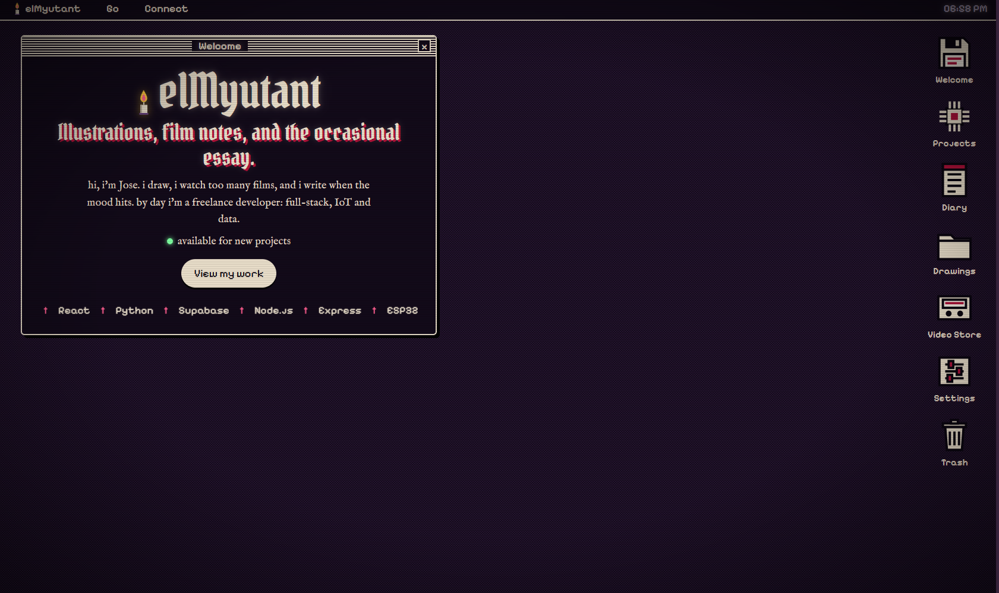

# elMyutant

A personal website built as an "operating system in the browser": a goth, retro-90s desktop with a menu bar, icons and windows. It holds my illustration gallery, a Letterboxd film shelf, a diary, and my freelance work.

**Live:** https://elmyutant.vercel.app


![![Video Store: the VHS shelf]](docs/screenshoot2.png)

## Features
- **Drawings**: gallery with tag filters and an image viewer. Uploads from a private admin are resized to WebP with `sharp` and stored in Supabase Storage.
- **Video Store**: my Letterboxd diary (public RSS feed) rendered as an angled VHS shelf, sortable by recent, rating or year, with a review window per film.
- **Diary**: Markdown posts written from an in-site editor, no git needed.
- **My Projects**: skills and projects, rendered from typed data.
- **Settings**: scanlines, text glow and animations, saved in `localStorage` and applied before first paint to avoid a flash.
- **Private admin**: email login with Supabase Auth cookies, server actions that re-check the user, Row Level Security as the last layer.

## Stack
Next.js 16 (App Router, Turbopack), TypeScript, Supabase (Postgres, Storage, Auth, RLS), `@supabase/ssr`, `react-markdown`, `sharp`, `fast-xml-parser`. Deployed on Vercel.

## Run it locally
```bash
npm install
npm run dev
```
Create `.env.local` (not committed) with your Supabase project values:
```
NEXT_PUBLIC_SUPABASE_URL=...
NEXT_PUBLIC_SUPABASE_ANON_KEY=...
```
(Use the same variable names as in `lib/supabase.ts`.) Never put the `service_role` key in the project.

## Notes
- The Letterboxd feed holds only the ~50 latest entries, so the shelf is a "recently watched" view that links to the full list.
- The site is built step by step as a Next.js learning project. See `NOTES.md` for what I learned at each stage.
